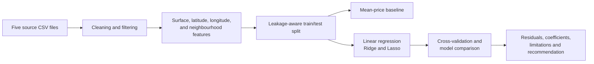

# Buenos Aires Apartment Price Prediction

An end-to-end supervised-learning project that estimates Buenos Aires apartment sale prices from property size and location features.

The project follows a reproducible modelling workflow: inspect and clean the source data, engineer features, establish a baseline, compare linear and regularised regression models, evaluate on the same held-out test set, and document the limits of the resulting predictions.

## Business question

Can apartment sale prices in Buenos Aires be predicted from surface area, location, and property characteristics?

The analysis focuses on apartments in Capital Federal priced below $400,000. This narrower market segment makes the comparison more coherent, but it also limits how broadly the model’s results can be applied.

## Modelling architecture



The workflow is:

1. Load five yearly CSV files and combine them.
2. Restrict the analysis to a consistent market segment.
3. Remove or transform unusable fields, extract location features, and handle missing values.
4. Split the data before fitting encoders and model-selection procedures.
5. Compare a mean baseline with linear, Ridge, and Lasso regression.
6. Use cross-validation to select regularisation strength.
7. Evaluate all candidates on the same held-out test set and inspect residual behaviour.

## Final result

The final recommendation is Lasso regression with `alpha=100`. It is not materially more accurate than Ridge or unregularised linear regression, but it provides a compact and interpretable model while retaining 51 of 59 encoded features.

| Model | Features | Test MAE | Test RMSE | Test R² |
|---|---|---:|---:|---:|
| Mean baseline | None | $45,233 | $61,059 | Approximately 0 |
| Linear regression | Surface | $31,843 | $45,143 | 0.4529 |
| Ridge | Surface, latitude, longitude, neighbourhood | $26,429 | $36,966 | 0.6331 |
| Lasso | Surface, latitude, longitude, neighbourhood | **$26,329** | **$36,916** | **0.6341** |

Compared with the mean baseline, the final model reduces test RMSE by approximately 39.5% and test MAE by approximately 41.8%. All reported metrics use the same 1,250-row held-out test set with `random_state=42`.

## Key findings

- Adding location features improves R² from 0.45 for the surface-only model to 0.63.
- Ridge and Lasso perform almost identically; their test RMSE differs by only about $49.
- The gain comes mainly from location features rather than a substantially different surface-area effect.
- Each additional square metre is associated with approximately $2,219 higher predicted price in the final Lasso model.
- Palermo, Belgrano, and Recoleta have the strongest positive neighbourhood effects in the fitted model, while Boca and Once have negative effects after controlling for the other included features.
- Prediction error grows with price: residual standard deviation increases from approximately $19,000 below $100,000 predicted to approximately $62,000 above $200,000 predicted.

The model is therefore useful for demonstrating a workflow and identifying broad relationships, but it should not be treated as a precise valuation tool for individual expensive properties.

## Data and reproducibility

The five raw CSV files were provided as course materials and are not redistributed. To reproduce the analysis:

1. Obtain the five files named `buenos-aires-real-estate-1.csv` through `buenos-aires-real-estate-5.csv` from the same course materials.
2. Place them in `data/raw/`.
3. Install [uv](https://docs.astral.sh/uv/).
4. Create the environment:

   ```bash
   uv sync
   ```

5. Run the notebooks in order using the project environment as the Jupyter kernel.

The preprocessing pipeline is also available in `src/wrangle.py`. Processed data is generated under `data/processed/` and is intentionally git-ignored.

## Repository structure

```text
.
├── data/
│   ├── raw/                 # source CSVs; not committed
│   └── processed/           # generated intermediate data; not committed
├── notebooks/
│   ├── 2.1_data_loading_cleaning_feature_engineering.ipynb
│   ├── 2.2_baseline_and_linear_regression.ipynb
│   ├── 2.3_ridge_and_lasso_regularization.ipynb
│   └── 2.4_model_selection.ipynb
├── reports/
│   └── figures/             # saved diagnostic charts
├── src/
│   └── wrangle.py           # reusable cleaning pipeline
├── pyproject.toml
├── uv.lock
└── README.md
```

## What this demonstrates

This project demonstrates practical foundations for Data Analyst, Analytics Engineering, and entry-level Data Science roles:

- Data cleaning and feature engineering with pandas
- Leakage-aware train/test splitting
- Reusable preprocessing and modelling workflows with scikit-learn
- Baseline comparison rather than reporting a model score in isolation
- Ridge and Lasso regularisation with cross-validation
- Evaluation using MAE, RMSE, and R²
- Residual diagnostics and model limitations
- Clear communication of assumptions, data provenance, and reproducibility steps

## Limitations and next steps

The model covers only mid-sized apartments in Capital Federal priced below approximately $400,000. Listings with missing surface area were removed, outlier bounds were calculated before the split, and results come from one fixed 80/20 split.

The raw data is course material, some neighbourhoods have few observations, and the model does not capture all factors that influence price. The error pattern suggests that a log-transformed target, nonlinear model, richer location features, repeated cross-validation, and calibration by price segment would be useful next steps.
