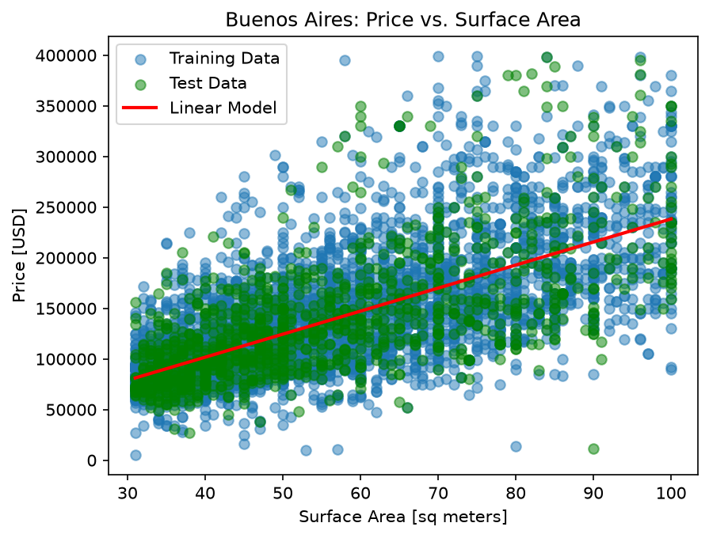
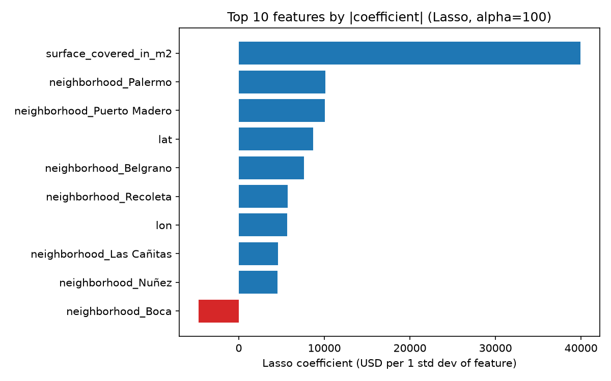
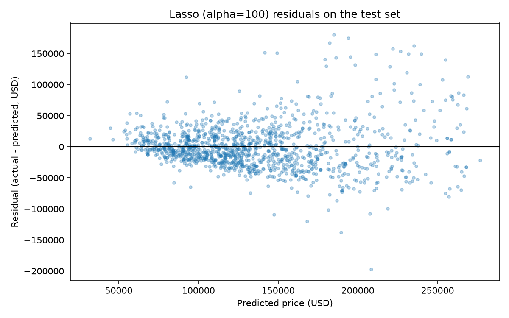

# Buenos Aires Apartment Price Prediction

Can we accurately predict apartment sale prices in Buenos Aires from size, type and location? This portfolio project works through the full supervised-learning workflow with scikit-learn: data cleaning, feature engineering, a leakage-free train/test split, a baseline, linear regression, and regularized models (Ridge and Lasso).

**Status:** Lessons 2.1 (data preparation), 2.2 (baseline and linear regression) and 2.3 (Ridge and Lasso regularization) complete. Model comparison and selection (2.4) in progress.

## Headline results

A single-feature linear model (covered surface area) cuts test MAE from $45.2k (mean baseline) to $31.8k (-29.6%), with test R² = 0.45. Train and test metrics agree, so the limit is the feature set, not overfitting. Each extra m² is associated with about $2,275 of additional price. Errors grow with price (residuals fan out above about $150k), and predictions cap near $240k. Lessons 2.3 and 2.4 add location and regularization to address this.



## Results by model

All metrics are on the same held-out test set (1,250 listings, `random_state=42`), so the rows are directly comparable.

| Model | Features | Test MAE | Test RMSE | Test R² |
|---|---|---|---|---|
| Mean baseline | none | $45,233 | n/a | about 0 |
| Linear regression (2.2) | surface | $31,843 | $45,143 | 0.4529 |
| Ridge, alpha=10 (2.3, CV-selected) | surface, lat, lon, neighborhood | $26,429 | $36,966 | 0.6331 |
| Lasso, alpha=100 (2.3, CV-selected) | surface, lat, lon, neighborhood | $26,329 | $36,916 | 0.6341 |

Adding location cuts test MAE by about 17% relative to the size-only model, and R² rises from 0.45 to 0.63. Ridge and Lasso perform the same within noise (RMSE differs by $49). Lasso reaches that accuracy with 51 of 59 features. The train-test RMSE gap is only about 11% for both, so regularization has little overfitting to fix: the remaining error comes from the linear form and the limited feature set.

Surface area is worth about $2,219 per extra m² in the Lasso model, close to the $2,275 from the size-only model, so the gain comes from location, not from a different size effect. The strongest well-supported neighborhood effects are Palermo, Belgrano and Recoleta (positive) and Boca and Once (negative).





## Limitations

- **Errors grow with price.** Residuals stay within about $50k below $150k predicted but spread to $150k or more above $175k. A log-transformed target or a nonlinear model is the natural next step.
- **Narrow scope.** Outliers were trimmed to the 10th-90th percentile of surface area, so the model only covers mid-sized apartments priced under about $400k.
- **Small leakage.** The outlier bounds were computed on the full dataset before the train/test split.
- **Suspicious listings.** A few listings are priced at roughly $5k-$15k and were not removed.
- **Thin neighborhoods.** Some neighborhoods have very few training listings (for example Puerto Madero has 39, Las Cañitas 21, Villa Soldati and Pompeya 4 each), so their dollar effects are unreliable. Six listings have a blank neighborhood name.
- **Coefficients are conditional.** Neighborhood effects are on top of surface, lat and lon and are shrunk by the Lasso penalty, so they are not raw price gaps.
- **One fixed split.** All results come from a single 80/20 split; I did not repeat the evaluation across different splits.

## Data

The raw listing data is not included in this repository (it comes from [SOURCE] and is not mine to redistribute).

1. Download `buenos-aires-real-estate-1.csv` through `buenos-aires-real-estate-5.csv` from [LINK OR INSTRUCTIONS].
2. Place them in `data/raw/`.
3. Run the notebooks in `notebooks/` in order.

`data/processed/` is created by the pipeline. Both data folders are git-ignored except for `.gitkeep` placeholders.

## Approach (Lesson 2.1)

- Loaded five yearly CSVs with `glob` and combined them with `pd.concat`.
- Restricted the market to Capital Federal apartments priced under $400,000, so the model learns one consistent segment.
- Trimmed outliers to the 10th-90th percentile of surface area (about [N]% of listings removed, leaving 6,507 rows).
- Extracted latitude, longitude and neighborhood from raw string columns.
- Dropped columns with more than 50% missing values, one of each highly correlated feature pair, price-derived columns (leakage), identifiers and single-value columns.
- One-hot encoded `neighborhood` with `category_encoders`, fitted on the training set only.
- 80/20 train/test split with `random_state=42`.

## Limitations

- The model only applies to mid-sized apartments in Capital Federal under $400,000.
- Outlier bounds were computed on the full dataset before the split, a small source of leakage.

## Notebooks

| Lesson | Notebook | Covers |
|---|---|---|
| 2.1 | `2.1_data_loading_cleaning_feature_engineering.ipynb` | Loading, filtering, outlier trim, feature extraction, missingness, multicollinearity, encoding, train/test split |
| 2.2 | `2.2_baseline_and_linear_regression.ipynb` | Mean baseline, single-feature linear regression, residual diagnostics |
| 2.3 | `2.3_ridge_and_lasso_regularization.ipynb` | Scaling and pipelines, Ridge and Lasso, alpha sweeps, RidgeCV/LassoCV, coefficient interpretation, residual diagnostics |
| 2.4 | (to come) | Model comparison and selection |

## Repo layout

```text
.
├── data/
│   ├── raw/          # source CSVs (not committed)
│   └── processed/    # intermediate outputs (not committed)
├── notebooks/
│   ├── 2.1_data_loading_cleaning_feature_engineering.ipynb
│   ├── 2.2_baseline_and_linear_regression.ipynb
│   └── 2.3_ridge_and_lasso_regularization.ipynb
├── reports/
│   └── figures/      # charts used in the README
├── src/
│   └── wrangle.py    # reusable cleaning pipeline
├── pyproject.toml
├── uv.lock
└── README.md
```

## Reproducing

Requires Python 3.12+ and [`uv`](https://docs.astral.sh/uv/).

```bash
git clone https://github.com/xrasana-lang/Buenos_Aires_price_prediction_using_Linear_Regression.git
cd Buenos_Aires_price_prediction_using_Linear_Regression
uv sync
```

Then open the notebooks in `notebooks/` in VS Code or Jupyter and select the `.venv` kernel.
