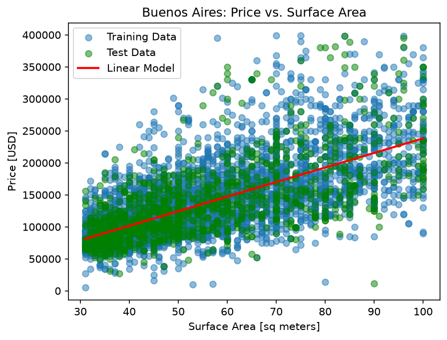
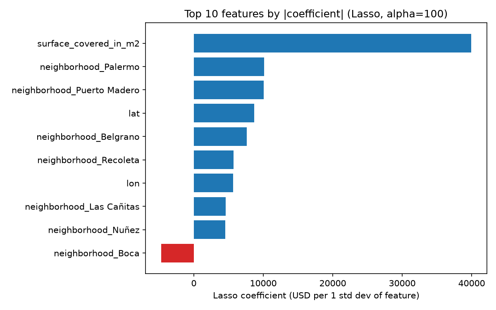
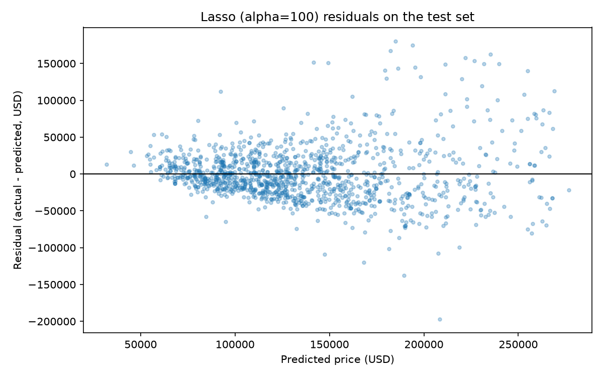
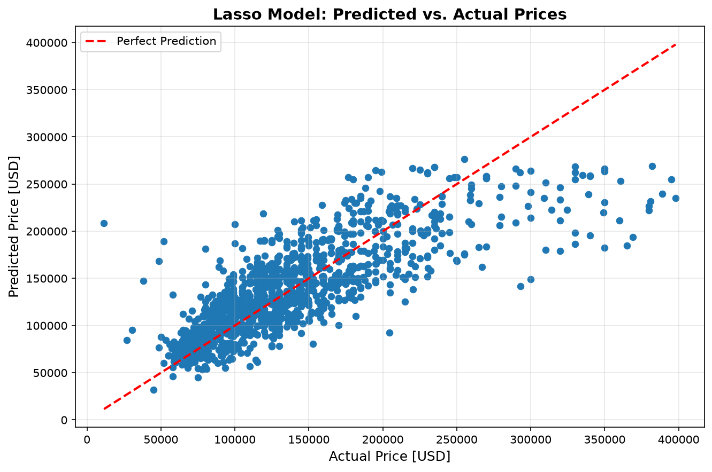

# Buenos Aires Apartment Price Prediction

Can we accurately predict apartment sale prices in Buenos Aires from size, type and location? This portfolio project works through the full supervised-learning workflow with scikit-learn: data cleaning, feature engineering, a leakage-free train/test split, a baseline, linear regression, and regularized models (Ridge and Lasso).

**Status:** All four lessons complete: 2.1 (data preparation), 2.2 (baseline and linear regression), 2.3 (Ridge and Lasso regularization) and 2.4 (model comparison and selection).

## Headline results

The final model, a Lasso regression (alpha=100, selected by cross-validation) on surface area, latitude, longitude and neighborhood, cuts test MAE from $45.2k (mean baseline) to $26.3k (-41.8%) and test RMSE from $61.1k to $36.9k (-39.5%), with test R² = 0.63. Surface area alone (the 2.2 model) reached R² = 0.45, so adding location accounts for the rest of the gain. Each extra m² is associated with about $2,219 of additional price. Ridge, Lasso and unregularized linear regression are tied within $55 of test RMSE, so Lasso is chosen for interpretability rather than accuracy. Typical error is about 28% of the mean price and grows with price (residual std about $19k below $100k predicted vs about $62k above $200k), which is the main limit of a linear model here.



## Results by model

All metrics are on the same held-out test set (1,250 listings, `random_state=42`), so the rows are directly comparable.

| Model | Features | Test MAE | Test RMSE | Test R² |
|---|---|---|---|---|
| Mean baseline | none | $45,233 | $61,059 | about 0 |
| Linear regression (2.2) | surface | $31,843 | $45,143 | 0.4529 |
| Ridge, alpha=10 (2.3, CV-selected) | surface, lat, lon, neighborhood | $26,429 | $36,966 | 0.6331 |
| Lasso, alpha=100 (2.3, CV-selected) | surface, lat, lon, neighborhood | $26,329 | $36,916 | 0.6341 |

Adding location cuts test MAE by about 17% relative to the size-only model, and R² rises from 0.45 to 0.63. Ridge and Lasso perform the same within noise (RMSE differs by $49). Lasso reaches that accuracy with 51 of 59 features. The train-test RMSE gap is only about 11% for both, so regularization has little overfitting to fix: the remaining error comes from the linear form and the limited feature set.

Surface area is worth about $2,219 per extra m² in the Lasso model, close to the $2,275 from the size-only model, so the gain comes from location, not from a different size effect. The strongest well-supported neighborhood effects are Palermo, Belgrano and Recoleta (positive) and Boca and Once (negative).





## Model selection (2.4)

Four candidates were compared on identical data (same cleaned rows, features, split and preprocessing), using RMSE. Ridge and Lasso alphas were chosen by cross-validation on the training data only, never by looking at test error.

| Model | Train RMSE | Test RMSE | Gap | Gap % |
|---|---|---|---|---|
| Mean baseline | $58,828 | $61,059 | $2,231 | 3.8% |
| Linear regression (all features) | $33,175 | $36,972 | $3,797 | 11.5% |
| Ridge (RidgeCV, alpha about 49.8) | $33,180 | $36,949 | $3,769 | 11.4% |
| Lasso (LassoCV, alpha=100) | $33,196 | $36,916 | $3,721 | 11.2% |

- **The three predictive models are tied.** Test RMSE differs by only $55 (0.15%), too small to rely on from a single fixed split. Lasso is chosen mainly because it is the easiest to explain: it drops 8 of 59 features (all sparse neighborhoods) and its largest coefficient is surface area, as expected.
- **Regularization did not reduce overfitting.** All three have a train-test gap of about 11%, so the limit is the linear form and the small feature set, not variance. Part of the gap is the test split itself: even the baseline's error is 3.8% higher on test.
- **Alpha checks.** RidgeCV chose alpha about 49.8 here (alpha=10 in 2.3, with a different grid and CV scheme); test RMSE is flat across that range. LassoCV chose alpha=100, the top of the lesson's grid, so I re-ran it on a wider grid: cross-validation RMSE differed by only $1.32 ($33,575.80 vs $33,577.12), so alpha=100 is kept.
- **Error grows with price.** Residual standard deviation by predicted price: about $19k (under $100k), $28k ($100k-$150k), $47k ($150k-$200k) and $62k ($200k-$300k). The headline RMSE overstates accuracy for expensive listings.



## Limitations

- **Errors grow with price.** Residuals stay within about $50k below $150k predicted but spread to $150k or more above $175k. Residual standard deviation rises from about $19k (predicted under $100k) to about $62k (above $200k). A log-transformed target or a nonlinear model is the natural next step.
- **Narrow scope.** Outliers were trimmed to the 10th-90th percentile of surface area, so the model only covers mid-sized apartments priced under about $400k.
- **Missing surface area.** 738 of the 8,774 filtered listings (about 8%) had no covered surface area and were dropped by the outlier step, so the model never sees them. Predictions for listings without a surface value are not possible with this model.
- **Small leakage.** The outlier bounds were computed on the full dataset before the train/test split.
- **Suspicious listings.** A few listings are priced at roughly $5k-$15k and were not removed.
- **Thin neighborhoods.** Some neighborhoods have very few training listings (for example Puerto Madero has 39, Las Cañitas 21, Villa Soldati and Pompeya 4 each), so their dollar effects are unreliable. Six listings have a blank neighborhood name.
- **Coefficients are conditional.** Neighborhood effects are on top of surface, lat and lon and are shrunk by the Lasso penalty, so they are not raw price gaps.
- **One fixed split.** All results come from a single 80/20 split; I did not repeat the evaluation across different splits.

## Data

The raw listing data is not included in this repository. The five CSV files (`buenos-aires-real-estate-1.csv` through `buenos-aires-real-estate-5.csv`) were provided as part of the course materials, so I do not redistribute them.

To reproduce the results:

1. Obtain the five CSV files from the same course materials.
2. Place them in `data/raw/`.
3. Run the notebooks in `notebooks/` in order.

`data/processed/` is created by the pipeline. Both data folders are git-ignored except for `.gitkeep` placeholders.

## Approach (Lesson 2.1)

- Loaded five yearly CSVs with `glob` and combined them with `pd.concat`.
- Restricted the market to Capital Federal apartments priced under $400,000, so the model learns one consistent segment.
- Trimmed outliers to the 10th-90th percentile of surface area (31-100 m²). Listings with missing surface area are also dropped by this step, so 2,267 of 8,774 filtered listings (about 26%) were removed, leaving 6,507 rows.
- Extracted latitude, longitude and neighborhood from raw string columns.
- Dropped columns with more than 50% missing values, one of each highly correlated feature pair, price-derived columns (leakage), identifiers and single-value columns.
- One-hot encoded `neighborhood` with `category_encoders`, fitted on the training set only.
- 80/20 train/test split with `random_state=42`.

## Limitations

- The model only applies to mid-sized apartments in Capital Federal under $400,000.
- Outlier bounds were computed on the full dataset before the split, a small source of leakage.

## Notebooks

| Lesson | Notebook | Covers |
|---|---|---|
| 2.1 | `2.1_data_loading_cleaning_feature_engineering.ipynb` | Loading, filtering, outlier trim, feature extraction, missingness, multicollinearity, encoding, train/test split |
| 2.2 | `2.2_baseline_and_linear_regression.ipynb` | Mean baseline, single-feature linear regression, residual diagnostics |
| 2.3 | `2.3_ridge_and_lasso_regularization.ipynb` | Scaling and pipelines, Ridge and Lasso, alpha sweeps, RidgeCV/LassoCV, coefficient interpretation, residual diagnostics |
| 2.4 | `2.4_model_selection.ipynb` | Four-model comparison (baseline, Linear, Ridge, Lasso) on identical data, reusable RMSE function, generalization gap, grid-edge check, residual and coefficient analysis, final recommendation |

## Repo layout

```text
.
├── data/
│   ├── raw/          # source CSVs (not committed)
│   └── processed/    # intermediate outputs (not committed)
├── notebooks/
│   ├── 2.1_data_loading_cleaning_feature_engineering.ipynb
│   ├── 2.2_baseline_and_linear_regression.ipynb
│   ├── 2.3_ridge_and_lasso_regularization.ipynb
│   └── 2.4_model_selection.ipynb
├── reports/
│   └── figures/      # charts used in the README
├── src/
│   └── wrangle.py    # reusable cleaning pipeline
├── pyproject.toml
├── uv.lock
└── README.md
```

## Reproducing

Requires Python 3.12+ and [`uv`](https://docs.astral.sh/uv/).

```bash
git clone https://github.com/xrasana-lang/Buenos_Aires_price_prediction_using_Linear_Regression.git
cd Buenos_Aires_price_prediction_using_Linear_Regression
uv sync
```

Then open the notebooks in `notebooks/` in VS Code or Jupyter and select the `.venv` kernel.
